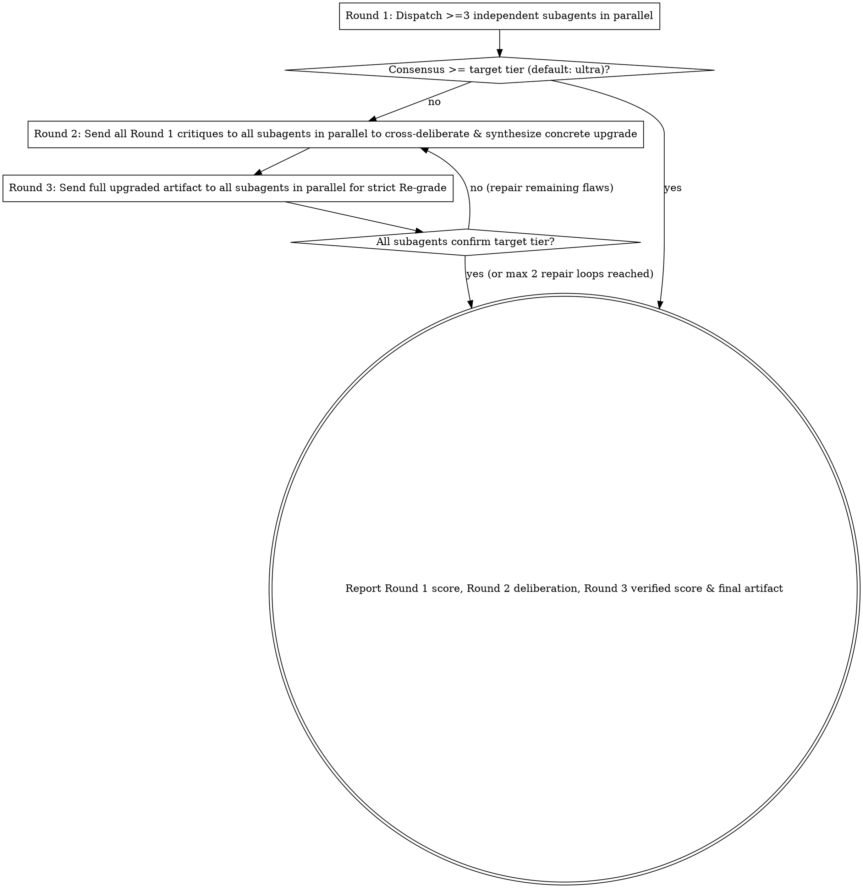

# Council Grade: Multi-Agent 5-Tier Deliberation & Re-grade Gate

## Overview

Evaluate and upgrade designs, specs, plans, architectures, or code through an independent multi-agent council using the strict 5-tier scale: `low` | `medium` | `hight` | `xhight` | `ultra`.

**Core principle:** A single agent grading or roleplaying multiple perspectives suffers from confirmation bias, and an unverified "upgrade" is an unsubstantiated claim. **Violating the letter of the rules is violating the spirit of the rules.**

**REQUIRED BACKGROUND:** You MUST understand `superpowers:dispatching-parallel-agents` for parallel subagent dispatch.

<HARD-GATE>
Never roleplay multiple experts inside a single agent response, never skip cross-deliberation, and never claim an upgraded artifact has reached `xhight` or `ultra` without passing Round 3 (Mandatory Re-grade Gate) by the subagent council.
</HARD-GATE>

## Superpowers Pipeline Integration

`superpowers:council-grade` serves both as a standalone invocation (`/council-grade`) and as the multi-agent quality gate across the `superpowers` workflow:

1. **Architectural Spec Gate (`superpowers:brainstorming`):** After writing the spec document (`docs/superpowers/specs/YYYY-MM-DD-<topic>-design.md`) and fixing obvious inline issues in *Spec Self-Review*, run `superpowers:council-grade` (target tier: `xhight` or `ultra`) before the *User Review Gate*. Commit the council-upgraded spec before presenting it to your human partner.
2. **Implementation Plan Gate (`superpowers:writing-plans`):** After completing the inline 4-point *Self-Review*, run `superpowers:council-grade` when the plan covers architectural/multi-subsystem work or when your human partner requests `xhight`/`ultra` assurance, verifying cross-task `Interfaces` (Consumes/Produces), `Global Constraints`, and `Review Focus` coverage before *Execution Handoff*.
3. **Final Branch Gate (`superpowers:subagent-driven-development` / `superpowers:executing-plans`):** At *Final Review*, when your human partner requests council-level verification or `ultra`-grade sign-off, dispatch the 3-specialist council over the branch review package before invoking `superpowers:finishing-a-development-branch`.

## The 5-Tier Calibration Rubric

Pass this exact rubric to every council subagent. Preserve the exact tier identifiers (`low`, `medium`, `hight`, `xhight`, `ultra`):

| Tier | Criteria |
|------|----------|
| `low` | Infeasible, contradicts core user requirements, or consists only of vague hand-waving without concrete structure. |
| `medium` | Works as a basic surface-level data/code sketch, but contains domain blind spots, cross-subsystem conflicts, or cosmetic metadata without execution semantics. |
| `hight` | Sound architecture covering core domain rules and primary edge cases, but still carries avoidable complexity, token/performance bottlenecks, or unresolved trade-offs. |
| `xhight` | Production-grade across both deep domain theory and real-world pipeline constraints; subsystems integrate cleanly with only minor local refinements remaining. |
| `ultra` | Uncompromising excellence across all specialist dimensions: resolves competing constraints into a unified, deterministic, minimal mechanism with zero unaddressed architectural flaws or bloat. |

## Mandatory 3-Round Protocol

### Round 1: Parallel Blind Grading
1. Select **3 orthogonal specialist roles** tailored to the task (e.g., *Domain Theory Critic*, *Systems/Compiler Architect*, *Production Pipeline Critic*).
2. Dispatch all 3 subagents **in a single response** using your platform's subagent dispatch tool (see **Multi-Agent Harness Tool Mapping** below).
3. Each prompt MUST be self-contained: include the user's verbatim requirements, the exact current artifact (or file path in the workspace), and the 5-Tier Calibration Rubric. Forbid grade inflation and emojis.
4. Require each subagent to return:
   - **Assigned Tier:** (`low` | `medium` | `hight` | `xhight` | `ultra`) and why it cannot be higher.
   - **Domain Blind Spots:** Concrete technical/domain flaws.
   - **Upgrade Requirements:** Specific architectural changes required for `ultra`.
5. The overall Round 1 grade is the **lowest tier** assigned by any council member (or strict majority if justified).

### Round 2: Cross-Deliberation & Concrete Synthesis
If Round 1 is below the target tier (default `ultra`):
1. Send all Round 1 critiques to all 3 subagents **in parallel** (resuming/messaging existing subagents where supported, or dispatching fresh parallel subagents carrying the Round 1 critiques).
2. Instruct each subagent to challenge proposals from the other specialists that would cause bloat or conflict with their domain, and propose a unified mechanism.
3. Synthesize their responses into a **complete, concrete upgraded artifact** (actual schema/spec/plan/code, not a bullet list of promises). If upgrading a spec or plan file on disk, write the upgraded content to the file.

### Round 3: Mandatory Re-grade Gate
1. Send the **complete upgraded artifact** back to all 3 subagents **in parallel**.
2. Instruct each subagent to re-grade the upgraded artifact from scratch against the 5-Tier Calibration Rubric, checking specifically for:
   - Unresolved Round 1 flaws,
   - New regressions or contradictions introduced during Round 2 synthesis,
   - Syntax or architectural bloat.
3. If any subagent grades below the target tier, fix the exact flaw and re-verify (up to 2 repair iterations). Never claim `ultra` if a subagent still grades `medium` or `hight`.

## Multi-Agent Harness Tool Mapping

Use your active harness's native subagent tools (see `../using-superpowers/references/`):

| Harness | Round 1 Parallel Dispatch (3 in 1 turn) | Round 2 & Round 3 Parallel Continuation |
|---------|------------------------------------------|-----------------------------------------|
| **Antigravity (`agy`)** | 3x `invoke_subagent` (`TypeName: "research"`, `Model: "inherit"`) | 3x `send_message` (`Recipient: "<conversationId>"`) |
| **Claude Code / Cursor / Copilot** | 3x `Agent` / `Task` (`subagent_type: "general-purpose"`) | 3x `Agent` / `Task` with `resume: "<agentId>"` (or fresh parallel dispatches with full Round 1/2 context) |
| **Codex (`codex`)** | 3x `spawn_agent` (`fork_turns: "none"`) | 3x `followup_task` targeting the 3 spawned agents |
| **Gemini CLI (`gemini`)** | 3x `invoke_agent` (`agent_name: "generalist"`) | 3x `invoke_agent` (`agent_name: "generalist"`) with self-contained Round 1 critiques / Round 2 artifact |
| **OpenCode V1 / V2** | V1: 3x `task` (`subagent_type: "general"`); V2: 3x `subagent` (`agent: "general"`) | V1: 3x `task`; V2: 3x `subagent` passing each member's `sessionID` |
| **Hermes Agent (`hermes`)** | 3x `delegate_task(goal=..., context=..., role="leaf")` | 3x `delegate_task` carrying Round 1 critiques / Round 2 artifact |
| **Muse (`muse`)** | 3x `subagent_spawn` | 3x `subagent_spawn` carrying Round 1 critiques / Round 2 artifact |
| **Kimi Code (`kimi`)** | 3x `Agent` (`subagent_type: "plan"` or `"coder"`) | 3x `Agent` carrying Round 1 critiques / Round 2 artifact |
| **Pi (`pi`)** | `subagent` tool (`pi-subagents` parallel mode) | `subagent` resume/parallel mode with Round 1/2 context |

## Required Output Contract

Present the final report to the user in four ordered sections:
1. **Round 1 Verdict (Initial Tier):** Individual scores, consensus tier, and root blind spots.
2. **Round 2 Cross-Deliberation:** Conflicts identified between specialists and how they were unified.
3. **Round 3 Re-grade Verification:** Post-upgrade scores from each specialist confirming the final tier.
4. **Upgraded Artifact:** The complete, verified `ultra`-tier design, spec, plan, or implementation.

## Rationalization Table (No Exceptions)

| Excuse | Reality |
|--------|---------|
| "I will roleplay all 3 experts in one response to save tokens and time" | Roleplaying in one context shares confirmation bias. You MUST dispatch 3 independent subagents in parallel. |
| "The user asked to go fast, so I will skip Round 3 Re-grade" | Merged proposals from 3 experts frequently introduce new contradictions or bloat. Round 3 Re-grade is mandatory. |
| "Round 2 already described how to reach `ultra`, no need to re-verify" | Describing an upgrade != verifying the upgraded artifact. Send the concrete upgraded artifact to Round 3. |
| "I will average `medium`, `hight`, and `ultra` to `hight`" | A fatal flaw in one critical domain blocks the whole system. Use the lowest substantiated tier until resolved. |
| "Inline Spec/Plan Self-Review passed, so `council-grade` is redundant" | Single-agent self-review shares the author's blind spots. Multi-agent council deliberation catches cross-domain conflicts before implementation. |

## Red Flags - STOP and Follow Protocol

- Generating multi-expert dialogue inside your own response without dispatching parallel subagents
- Presenting an upgraded design as `ultra` right after Round 2 without sending it back to the subagents for Round 3 Re-grade
- Passing your preferred grade or leading hints in subagent prompts
- Using emojis anywhere in prompts or reports
